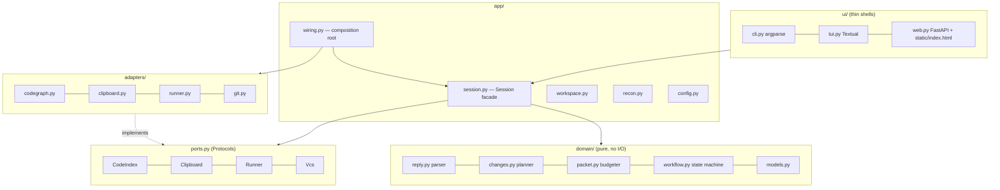
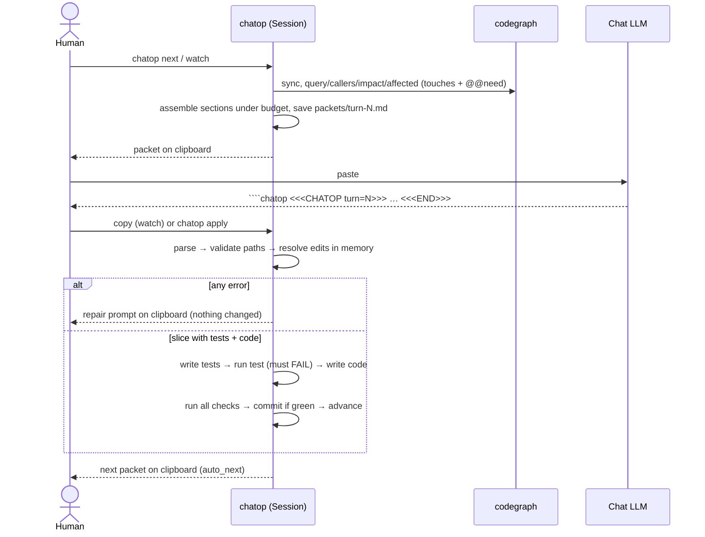
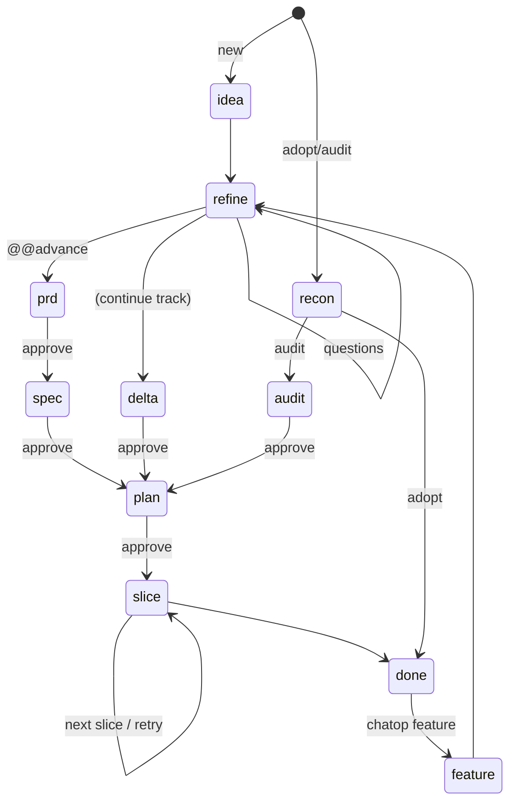

# Architecture

## Layers and the import rule



| Layer | May import | Must not import |
|---|---|---|
| `domain` | stdlib, `domain` | everything else |
| `ports` | stdlib | everything else |
| `adapters` | stdlib, `ports` | `domain`, `app`, `ui` |
| `app` | `domain`, `ports`, stdlib | `adapters` (except `wiring.py`), `ui` |
| `ui` | `app`, `domain.models` (enums) | `adapters`, `domain` internals |

**Why it stays local.** A new code-search tool is one adapter. A new UI is one shell over `Session`. A new phase is one
prompt file plus one entry in `workflow.TRACKS`. A reply-format change touches `reply.py` and `contract.md` only.

## Boundary surfaces (the only things that cross)

| Boundary | Surface |
|---|---|
| LLM → chatop | text, through `parse_reply(text) -> Reply` |
| chatop → LLM | text, from `assemble(sections, budget) -> (str, notes)` |
| UI → core | 14 `Session` methods: `init, detect_track, build_packet, apply, answer, accept_recommended, approve, reject, accept_checks, feature, undo, watch_tick, status, doctor` |
| core → codegraph | `CodeIndex` (9 methods), CLI flags `--json`, `--limit`, `--depth`, `--quiet` |
| core → OS | `Clipboard.copy/paste`, `Runner.run`, `Vcs` (5 methods), and `Workspace` (root-confined fs) |

## One turn, end to end



## State machine



Statuses: `ready → awaiting_reply → (awaiting_answers | awaiting_approval | ready) … → done`.

## Data layout in a managed project

```
.chatop/
  config.toml      human-owned: checks, gates, budget, protected globs, tdd_strict, auto_commit, auto_next
  state.json       track, phase, status, turn, slices, questions, needs, decisions, history, evidence (commit it)
  journal.jsonl    append-only audit trail of every init/apply/reject/approve
  packets/ replies/ undo/   per-turn artifacts (git-ignored)
docs/              the human-readable memory the LLM maintains
```

## Testing strategy (chatop itself)

| Level | Folder | Notes |
|---|---|---|
| Domain unit | `tests/domain` | parser edge cases, planner validation, budgeter, workflow transitions |
| Adapter contract | `tests/adapters` | codegraph command lines and schema-tolerant parsing via an injected exec fn |
| Use cases | `tests/app` | `Session` against real git and real pytest in temp dirs, with a fake index and clipboard |
| UI shells | `tests/ui` | CLI via `main(argv, factory)`, web via TestClient, TUI via the Textual pilot |
| End to end | `tests/e2e` | all four labs replayed with reference replies |

The tests were written first; several real defects were found this way (packet self-apply in watch mode, stale `.pyc`
in fast edit loops, code-only retry blocked by strict TDD, missing audit evidence after a late check acceptance).
