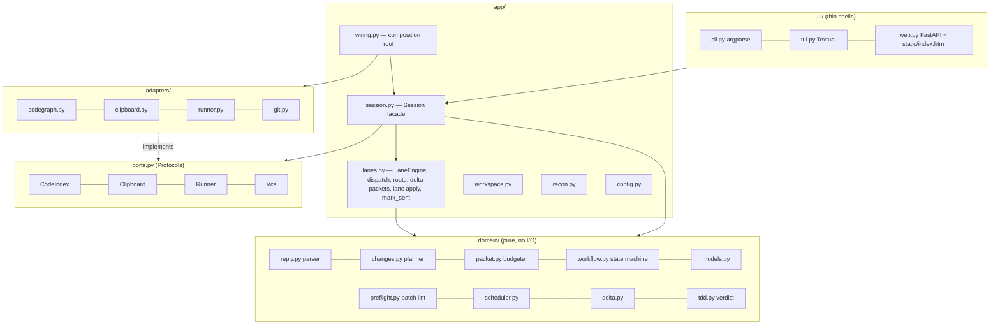
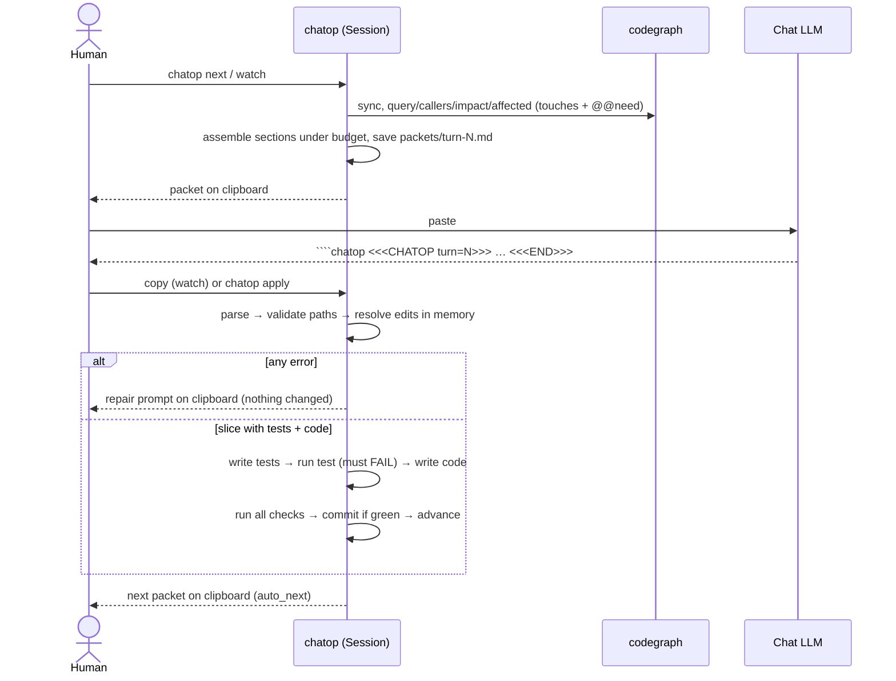
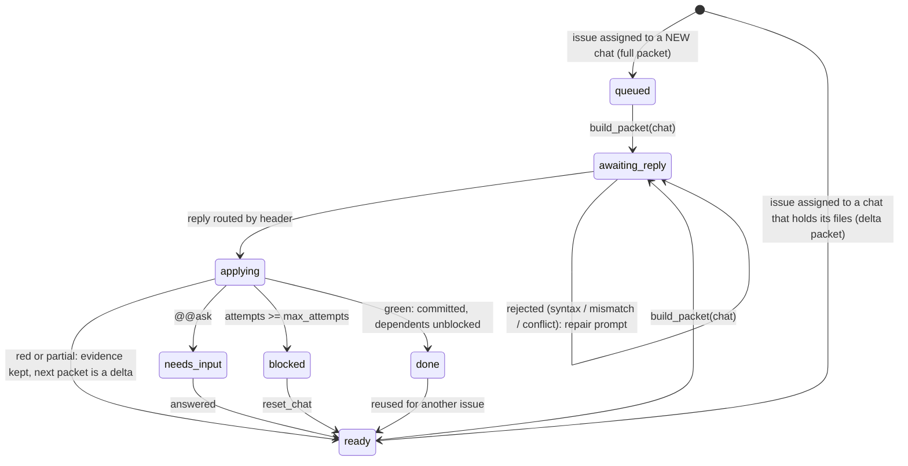
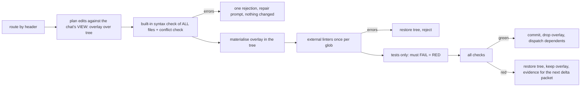
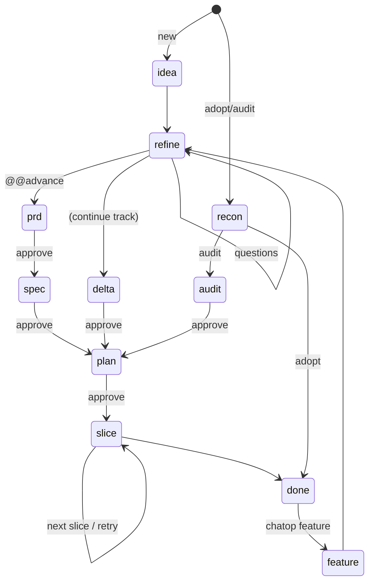

# Architecture

## Layers and the import rule



| Layer | May import | Must not import |
|---|---|---|
| `domain` | stdlib, `domain` | everything else |
| `ports` | stdlib | everything else |
| `adapters` | stdlib, `ports` | `domain`, `app`, `ui` |
| `app` | `domain`, `ports`, stdlib | `adapters` (except `wiring.py`), `ui` |
| `ui` | `app`, `domain.models` (enums) | `adapters`, `domain` internals |

**Why it stays local.** A new code-search tool is one adapter. A new UI is one shell over `Session`. A new phase is one
prompt file plus one entry in `workflow.TRACKS`. A reply-format change touches `reply.py` and `contract.md` only.

## Boundary surfaces (the only things that cross)

| Boundary | Surface |
|---|---|
| LLM → chatop | text, through `parse_reply(text) -> Reply` |
| chatop → LLM | text, from `assemble(sections, budget) -> (str, notes)` |
| UI → core | `Session`: `init, detect_track, build_packet(chat=, full=), apply, answer(chat=), accept_recommended(chat=), approve, reject, accept_checks, feature, undo, watch_tick, status, doctor` plus the parallel surface `dispatch, assign, next_up, route, board, events_since, reset_chat, configure` (the UIs never import `LaneEngine`) |
| core → codegraph | `CodeIndex` (9 methods), CLI flags `--json`, `--limit`, `--depth`, `--quiet` |
| core → OS | `Clipboard.copy/paste`, `Runner.run`, `Vcs` (5 methods), and `Workspace` (root-confined fs) |

## One turn, end to end



## Parallel relay (lanes)

A *chat* is one browser tab the human relays to. State lives in `State.chats` and `State.events`; each issue (slice)
has `depends`, `touches` and `lane`. The UIs do not show the raw status: `domain/stage.py` derives who acts next
(`send`/`paste`/`fix`/`answer`/`blocked` = you, `waiting` = the LLM, `applying` = chatop, `closed`) from the status, the
"I pasted it" flag (`Chat.sent_at`) and the repair prompt, and `board()` returns it with a summary (docs/UX.md).



**Applying a reply in a lane** (`LaneEngine._apply_checked`, under the session's `_apply_lock`):



Isolation uses an overlay plus serialised applies instead of git worktrees: no per-chat checkout, no dependency
reinstall, and the check commands run in the real project directory. The cost is that applies queue (the LLM wait,
not the apply, is what overlaps). Locks: `_apply_lock` guards the tree; `_state_lock` guards short state mutations so
the UIs can poll `board()` while checks run.

**Delta packets.** `domain.delta.plan_delta` compares `chat.seen` (content digests of what the chat holds) with the
current documents, files and repo map. A full packet sends everything and records the digests; a delta sends the
changed items and names the rest. Files the chat wrote itself are recorded after each apply so they are not sent back.

**Events.** Every transition that matters to a human (`ready`, `done`, `question`, `blocked`, `rejected`, `finished`)
appends `{seq, ts, kind, chat, issue, text}` to `State.events`. UIs poll `board()` and show anything newer than the
last `seq` they saw: toast + tab title in the web UI, notifications in the TUI, `chatop board` in the CLI.

## State machine



Statuses: `ready → awaiting_reply → (awaiting_answers | awaiting_approval | ready) … → done`.

## Data layout in a managed project

```
.chatop/
  config.toml      human-owned: checks, gates, budget, protected globs, tdd_strict, auto_commit, auto_next,
                   max_parallel, max_attempts, max_issues_per_chat, auto_dispatch, delta_packets, [preflight]
  state.json       track, phase, status, turn, slices (+depends, lane), chats, events, questions, needs, decisions,
                   history, evidence (commit it)
  journal.jsonl    append-only audit trail of every init/apply/reject/approve
  packets/ replies/ undo/ lanes/   per-turn artifacts and per-chat overlays (git-ignored; chat packets are cN-turn-NNNN.md)
docs/              the human-readable memory the LLM maintains
```

## Testing strategy (chatop itself)

| Level | Folder | Notes |
|---|---|---|
| Domain unit | `tests/domain` | parser edge cases, planner validation, budgeter, workflow transitions |
| Adapter contract | `tests/adapters` | codegraph command lines and schema-tolerant parsing via an injected exec fn |
| Use cases | `tests/app` | `Session` against real git and real pytest in temp dirs, with a fake index and clipboard |
| UI shells | `tests/ui` | CLI via `main(argv, factory)`, web via TestClient, TUI via the Textual pilot |
| End to end | `tests/e2e` | all five labs replayed with reference replies; the mock UI is rebuilt and its scenario run under node |

The tests were written first; several real defects were found this way (packet self-apply in watch mode, stale `.pyc`
in fast edit loops, code-only retry blocked by strict TDD, missing audit evidence after a late check acceptance).
