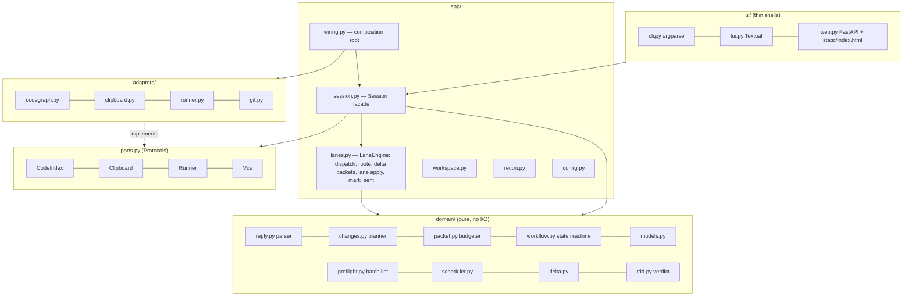
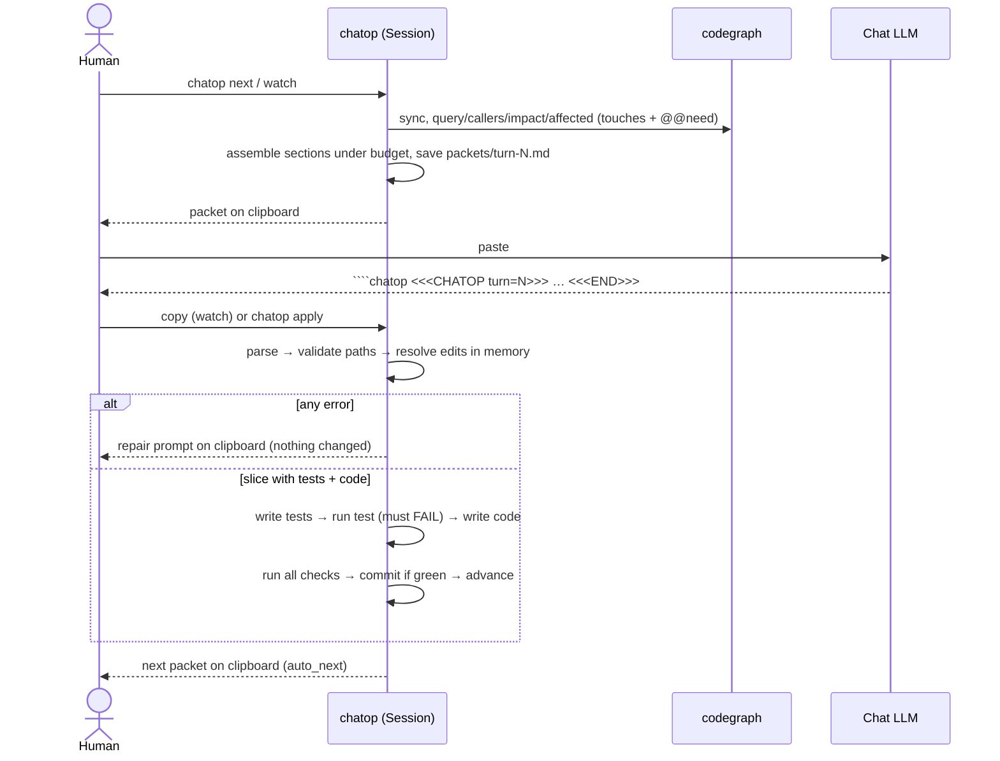
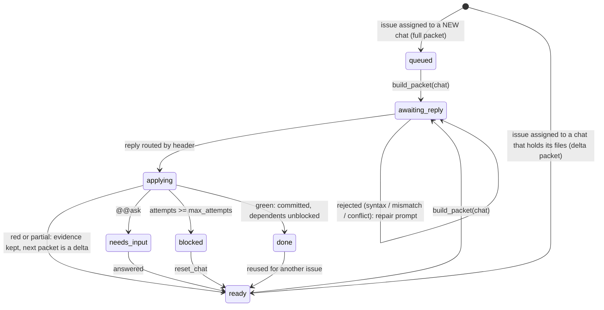
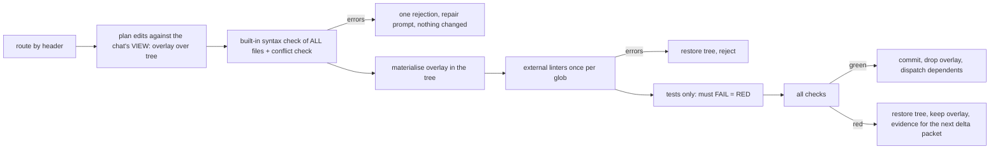
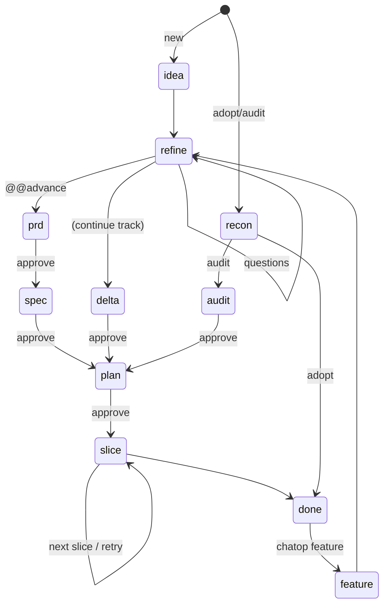

# chatop spec bundle

Every spec file below is delimited by `<!-- BEGIN FILE: path -->` and
`<!-- END FILE: path -->`; extract by those markers. Read in this order: PRD, DESIGN,
ARCHITECTURE, BEHAVIOR, DECISIONS, UX. Requirement ids (FR-n, NFR-n, UC-n, R-n) are stable
and are the scope of any implementation or integration.

<!-- BEGIN FILE: docs/PRD.md -->
# PRD: chatop

| | |
|---|---|
| Document | Product requirements, v0.1 |
| Status | Implemented in the reference repo; this document is the spec for rebuilding it or porting it into another product |
| Companion docs | `DESIGN.md` (modules, traceability, integration), `ARCHITECTURE.md` (layers, flows, state machine), `BEHAVIOR.md` (externally visible contract), `DECISIONS.md` (ADRs), `UX.md` (relay UX) |
| IDs | `P-n` persona, `UC-n` use case, `FR-n` functional, `NFR-n` non-functional, `R-n` risk. IDs are stable; never renumber, only append |

## 1. Summary

**chatop** is a local tool that lets a person build and maintain software with chat LLMs (Claude, ChatGPT, Gemini and
similar) that have no access to the repository. It owns project state, builds the exact text to paste into a chat
(a **packet**), and applies the chat's structured answer (a **reply**) to the repo with checks. The human's work per
turn is two actions: copy the packet to the chat, copy the reply back.

## 2. Problem

Using a chat window as a developer is limited by everything around the model, not by the model:

1. **Context gathering is manual and lossy.** The human assembles files, errors and history by hand, every turn.
2. **Applying output is manual and error-prone.** Code arrives as prose and fragments; edits are applied by hand and
   syntax errors are found one file at a time, one turn at a time.
3. **Nothing enforces engineering discipline.** "Tests first" is on the honour system; replies are trusted, not checked.
4. **State is lost between turns and between chats.** Several chats cannot work in parallel without the human
   becoming the scheduler and the merge tool.
5. **Unknown codebases are hard to enter.** Code written by other agents, of unknown quality, has no map, no tests
   and no stated intent.

## 3. Users

| ID | Persona | Situation | Needs most |
|---|---|---|---|
| P-1 | Solo builder | Has an idea and only chat access (or prefers it) | Idea to shipped slices with minimal turns; discipline enforced for them |
| P-2 | Engineer on an existing product | Adds features to a repo; may use several chats at once | Parallel work that does not collide; small packets; safe application |
| P-3 | Maintainer of an unknown codebase | Inherits code written by coding agents of unknown kind and quality | A map, an evidence-based assessment, and a safe path to change it |
| P-4 | Integrator | Wants this workflow inside another tool or process | Narrow, stable surfaces; a language-agnostic contract |

## 4. Goals and non-goals

**Goals**

* G-1 Minimise human effort and tokens per turn: one copy out, one copy back, optimised context.
* G-2 Make replies safe by construction: validated as a batch, applied atomically, tests proven red then green.
* G-3 Support four situations with one tool: new project, continue, adopt unknown code, audit unknown quality.
* G-4 Let the human run several chats in parallel and always show whose move it is.
* G-5 Keep the integration surface narrow so a change stays local.
* G-6 Be rebuildable through chat alone (the bootstrap plays) and able to adopt itself.

**Non-goals**

* NG-1 No coding agent, harness or autonomous loop. A human is always the relay.
* NG-2 No direct LLM API calls. Chat UIs are the interface.
* NG-3 No Windows support. macOS and Linux only.
* NG-4 No replacement for CI, code review or an issue tracker. chatop keeps its own small plan, not a project-management system.
* NG-5 No code search of its own. The `codegraph` CLI is the only code search used.

## 5. Constraints

| ID | Constraint |
|---|---|
| C-1 | macOS and Linux only |
| C-2 | Code search is the `codegraph` CLI (npm `@colbymchenry/codegraph`) and nothing else |
| C-3 | No coding harness may be invoked by chatop or by the process that builds it |
| C-4 | Python 3.11+, type annotations everywhere, `mypy --strict` and `ruff` clean |
| C-5 | TDD for chatop itself; the apply step enforces it for managed projects |
| C-6 | Chat context windows are at least 250K tokens; packets still have a budget |
| C-7 | Interfaces: CLI, web UI (FastAPI) and TUI (Textual), all over one core |

## 6. Use cases

| ID | Use case | Persona | Flow | Reference lab |
|---|---|---|---|---|
| UC-1 | New project | P-1 | idea, refine, PRD, SPEC, plan, slices, done | `new-project` |
| UC-2 | Continue: add a feature | P-1, P-2 | feature, refine, delta, plan, slices, done | `continue-feature` |
| UC-3 | Adopt an unknown project | P-3 | recon (map, churn, tests, agent markers), then work as UC-2 | `adopt` |
| UC-4 | Audit unknown quality | P-3 | recon, audit (findings, characterization tests), plan, slices | `audit` |
| UC-5 | Parallel relay | P-2 | plan becomes issues, issues go to chats, replies routed by chat id | `parallel-relay` |
| UC-6 | Manual mode | P-1 | the same protocol with copy/paste prompts and no app (the playbook) | n/a |
| UC-7 | Rebuild or integrate | P-4 | rebuild from the plays, or take one layer into another product | `bootstrap/accept.py` |

## 7. Functional requirements

Priority: **M** must, **S** should, **C** could. "Verified by" names the lab (`accept.py` replays them through the CLI)
or the kind of test.

### 7.1 Workflow and state

| ID | Requirement | Pri | UC | Verified by |
|---|---|---|---|---|
| FR-1 | Provide tracks `new`, `continue`, `adopt`, `audit`, each a fixed sequence of phases | M | 1-4 | labs 1-4 |
| FR-2 | `init` detects the track (empty or no code: new; code with tests: adopt) and accepts an explicit track | M | 1,3 | labs 1,3; unit |
| FR-3 | Gated phases (PRD, SPEC, delta, plan, audit by default) wait for explicit human approval; rejection returns the phase with the human's note | M | 1-4 | labs 1,2,4 |
| FR-4 | Refinement is bounded (rounds and questions per round) and questions carry recommended options the human can accept in one action | M | 1,2 | labs 1,2 |
| FR-5 | The plan is structured data: slices with id, goal, depends, touches, tests, acceptance; invalid plans (unknown dependency, cycle, duplicate id) are rejected with all problems listed | M | 1,2 | unit |
| FR-6 | `feature` starts the continue track on a finished project and refuses mid-phase unless forced | M | 2 | lab 2 |
| FR-7 | All state is on disk (`state.json`, append-only journal) so any session or shell can resume | M | all | unit; labs |

### 7.2 Packets (chatop to chat)

| ID | Requirement | Pri | UC | Verified by |
|---|---|---|---|---|
| FR-10 | Build one self-contained packet per turn: contract, phase prompt, project memory, relevant code (from codegraph), evidence of the last failure, and the exact first line the reply must start with | M | all | labs; unit |
| FR-11 | Respect a token budget; drop the lowest-priority context first and say what was dropped | M | all | unit |
| FR-12 | Copy the packet to the system clipboard; fall back to a file; a pasted packet is never accepted as a reply | M | all | unit |
| FR-13 | Continuing chats receive a delta packet (only changed context); new chats receive a full packet | M | 5 | lab 5 |
| FR-14 | Save every packet and reply for audit | S | all | unit |

### 7.3 Replies and apply (chat to chatop)

| ID | Requirement | Pri | UC | Verified by |
|---|---|---|---|---|
| FR-20 | Parse a line-oriented envelope: header with chat and turn, directives for summary, files, tests, docs, edits, deletes, questions, slices, needs, decisions, checks, runs, advance, and a terminator | M | all | unit; labs |
| FR-21 | Reject truncated replies (no terminator) and pasted packets | M | all | unit |
| FR-22 | Validate the whole reply as a batch before writing anything: path safety, edit matching, and syntax of every generated Python, JSON and TOML file; report all problems at once with one repair prompt | M | all | unit; labs |
| FR-23 | Apply atomically: a rejected reply changes nothing | M | all | unit; labs |
| FR-24 | Edits are SEARCH/REPLACE blocks that must match exactly once, with a whitespace-tolerant fallback | M | all | unit |
| FR-25 | Reject a reply whose turn or chat does not match the packet it answers (stale) | M | all | unit; lab 5 |
| FR-26 | On success commit automatically with the reply's summary and prepare the next packet | S | all | labs |
| FR-27 | Undo the last applied, uncommitted reply | S | all | unit |
| FR-28 | The LLM may request more context (`need`: symbol, file, callers, callees, impact, affected) and the next packet satisfies it through codegraph | S | 2,3 | unit |

### 7.4 TDD and checks

| ID | Requirement | Pri | UC | Verified by |
|---|---|---|---|---|
| FR-30 | In slice work, tests are applied first and must fail with the code held back (red proof); then the code is applied and the checks must pass (green) | M | 1,2,5 | labs 1,2,5 |
| FR-31 | A code-only retry is allowed after a failing attempt of the same slice; the audit track and an explicit advance relax red proof for characterization or refactoring | M | 4 | lab 4 |
| FR-32 | Checks are commands owned by the human; the LLM may only propose checks, and a proposal is never executed until accepted | M | all | unit |
| FR-33 | A slice that fails checks keeps its files in place and returns the evidence in the next packet; after a bounded number of attempts it blocks for a human decision | M | all | unit |

### 7.5 Parallel relay

| ID | Requirement | Pri | UC | Verified by |
|---|---|---|---|---|
| FR-40 | Turn the approved plan into issues; an issue is ready when its dependencies are done | M | 5 | lab 5 |
| FR-41 | Never run two issues at once whose `touches` overlap; an issue with unknown touches overlaps everything | M | 5 | unit; lab 5 |
| FR-42 | Assign ready issues to chats: reuse a chat that already holds related files up to a limit, otherwise open a new one; the human can override | M | 5 | lab 5 |
| FR-43 | Route a pasted reply to its chat by the header, in any order, from any chat | M | 5 | lab 5 |
| FR-44 | Show for every chat whose move it is: your move, waiting for the LLM, applying, closed; let the human flag "packet pasted" | M | 5 | lab 5; UI tests |
| FR-45 | Publish a monotonic event sequence so UIs can refresh without polling everything | S | 5 | unit |

### 7.6 Unknown projects

| ID | Requirement | Pri | UC | Verified by |
|---|---|---|---|---|
| FR-50 | Recon builds evidence for an unknown repo from codegraph and git: structure map, entry points, change churn, test inventory and failing tests, and markers of which agents wrote it | M | 3,4 | labs 3,4 |
| FR-51 | Adopt ends with a recon document and configured checks, after which the project continues on the continue track | M | 3 | lab 3 |
| FR-52 | Audit produces findings with severity and characterization tests that pin current behaviour before any change | S | 4 | lab 4 |

### 7.7 Interfaces and safety

| ID | Requirement | Pri | UC | Verified by |
|---|---|---|---|---|
| FR-60 | A CLI exposes every operation, with `status --json`, a global project-root option and stable exit codes (0 ok, 1 rejected, 3 applied but checks failed) | M | all | labs (through `accept.py`) |
| FR-61 | A web UI (FastAPI) shows projects, the per-project board by stage, a paste box that routes automatically, and approve/reject; it contains no business logic | M | 5 | UI tests |
| FR-62 | A TUI (Textual) offers the same board and actions, keyboard first | S | 5 | UI tests |
| FR-63 | `watch` applies replies as they appear on the clipboard and copies the next packet | C | all | unit |
| FR-64 | `doctor` reports the environment (tools found, index state, clipboard adapter) | S | all | unit |
| FR-70 | Writes are confined to the project root; `.git`, chatop state, secrets and configured protected paths are never writable by a reply | M | all | unit |
| FR-71 | A command string coming from a reply is never executed; only configured checks run | M | all | unit |

## 8. Non-functional requirements

| ID | Requirement |
|---|---|
| NFR-1 | Runs on macOS and Linux with Python 3.11+, git, and codegraph; no network access of its own (web UI binds to localhost) |
| NFR-2 | Narrow integration surface: a pure domain core, five ports, one adapter per port, one use-case facade, thin shells. Layer import rules are enforced by `tests/test_layers.py` |
| NFR-3 | Every external dependency is injectable; the core is testable without git, a clipboard or codegraph |
| NFR-4 | `mypy --strict` and `ruff` clean; modules stay small and single-purpose (guideline: about 400 lines; the reference has two larger ones, `app/lanes.py` and `app/session.py`) |
| NFR-5 | Human actions per turn: two (copy out, copy in). Everything else is automatic or a one-key decision |
| NFR-6 | UX follows the relay model in `UX.md`: one primary action per screen, visible status, no hidden waiting |
| NFR-7 | Failure is evidence, not a dead end: every rejection says what, where, and how to repair, in one message |
| NFR-8 | The envelope and apply rules are language-agnostic and fully described in `BEHAVIOR.md` so another implementation can be conformant |

## 9. Success measures

These are **targets to measure**, not results; the reference repo has not been measured with real chats.

| Measure | Target | How to measure |
|---|---|---|
| Replies applied on the first attempt | 80% or more | journal: applied vs rejected per turn |
| Pastes per finished slice | 2 or fewer median | journal: turns per slice |
| Human actions per turn | 2 | by construction (NFR-5) |
| Time from idea to first green slice | one session | wall clock |
| Parallel speed-up with 3 chats | 2x or more on independent slices | wall clock vs serial |

## 10. Release scope

* **v0.1 (this PRD):** FR-1 to FR-71 above; five labs; the bootstrap plays and conformance oracle.
* **Later (not committed):** configurable token budget per chat; project memory export; journal viewer; more chat-UI
  quirks tolerated by the parser; keyboard shortcuts in the web board; richer audit reports; per-language preflight
  plugins.

## 11. Acceptance

The release is acceptable when all of these hold:

1. The test suite passes, `mypy --strict` and `ruff` are clean.
2. `accept.py all` passes the five labs through the CLI.
3. The kernel acceptance script passes 9 of 9.
4. The layer rules in `ARCHITECTURE.md` hold (`tests/test_layers.py` passes).

## 12. Risks

| ID | Risk | Mitigation |
|---|---|---|
| R-1 | Chat UIs mangle fences or copy buttons | 4-backtick fence, tolerant parser, explicit repair prompts, failure guide |
| R-2 | Long replies are truncated | terminator required; replies split by slice; `@@edit` for follow-ups |
| R-3 | The LLM weakens tests to pass | red proof, human review of test diffs, human-owned checks |
| R-4 | codegraph output shape changes | one adapter, tolerant parsing, contract tests with injected exec |
| R-5 | Two chats edit the same file | `touches` exclusion, serialized apply, SEARCH must match once |
| R-6 | Context grows beyond the window | token budget, delta packets, memory in docs not in chat history |
| R-7 | A rebuilt implementation drifts from the original | conformance labs as oracle, `BEHAVIOR.md` as contract |

## 13. Open questions

* OQ-1 Which chat UIs need tolerance beyond the current parser (smart quotes, code-block rewriting)?
* OQ-2 Should the token budget be calibrated from observed rejections instead of a fixed estimate (4 characters per token)?
* OQ-3 Is a per-language preflight plugin interface worth its surface, or should non-Python projects rely on checks only?

## 14. Glossary

| Term | Meaning |
|---|---|
| Packet | The text chatop builds for the human to paste into a chat |
| Reply | The structured text a chat returns; parsed and applied by chatop |
| Envelope | The reply grammar: header, directives, terminator |
| Slice | The unit of work: tests plus code, one reply |
| Issue | A slice assigned to a chat, with dependencies and touched files |
| Delta | A packet carrying only what changed since the chat's last packet |
| Red proof | Evidence that new tests fail before the code is applied |
| Recon | Evidence gathering for an unknown project |
| Kernel | The standard-library bootstrap script that builds packets and applies replies before chatop exists |
<!-- END FILE: docs/PRD.md -->

<!-- BEGIN FILE: docs/DESIGN.md -->
# Design: chatop

Companion to `PRD.md` (what and why). This document is the **how, at module level**, the **traceability from every
requirement to a module and a test**, and the **guide for taking chatop (or one layer of it) into another product**.
Diagrams, flows and the state machine are in `ARCHITECTURE.md`; the externally visible contract is `BEHAVIOR.md`.

## 1. System context

```
 human ──copy packet──►  chat LLM (Claude / ChatGPT / Gemini, no repo access)
   ▲  │                        │
   │  └──────◄── reply ────────┘
   │
   ▼
 ┌──────────────────────────── chatop (local) ──────────────────────────────┐
 │  shells:  CLI · web (FastAPI) · TUI (Textual)        no business logic    │
 │      │                                                                    │
 │  app:  Session facade · LaneEngine · Workspace · Config · recon          │
 │      │                                                                    │
 │  domain (pure):  reply · changes · preflight · tdd · workflow ·           │
 │                  scheduler · stage · packet · delta · models              │
 │      │                                                                    │
 │  ports: CodeIndex · Clipboard · Runner · Vcs                              │
 └──────┼────────────────────────────────────────────────────────────────────┘
        ▼
  adapters: codegraph CLI · pbcopy/wl-copy/xclip/file · shell · git        project repo + .chatop/
```

## 2. Design principles

1. **Text at the edges, types inside.** Everything that crosses the LLM boundary is text; it becomes typed data once
   (`parse_reply`) and typed data becomes text once (`assemble`).
2. **A pure core.** `domain` does no I/O. Every decision (what to apply, what is ready, whose move it is) is a function.
3. **Narrow surfaces.** Five ports, one facade (`Session`), one reply parser, one packet assembler. A change stays local.
4. **Evidence over claims.** A reply is trusted only after it is validated, applied, and its tests proven red then green.
5. **The human owns the gates.** Approvals, checks and unblocking are human decisions; the LLM may propose, never execute.
6. **State is files.** `state.json` plus an append-only journal; every shell and every restart sees the same truth.

## 3. Module map

| Module | Responsibility | Implements |
|---|---|---|
| `domain/models.py` | enums (track, phase, status), `State`, `Slice`, `Question`, `Chat`, JSON round trip | FR-1, FR-5, FR-7 |
| `domain/workflow.py` | tracks as data, transitions, gates, auto-advance, slice activation, `start_feature` | FR-1, FR-3, FR-6 |
| `domain/reply.py` | `parse_reply(text) -> Reply`; every directive; truncated and pasted-packet detection | FR-20, FR-21 |
| `domain/changes.py` | `plan_changes`: path safety, protected globs, exact-once edits with tolerant fallback | FR-22, FR-24, FR-70 |
| `domain/preflight.py` | one-shot syntax check of every generated Python, JSON, TOML file; repair prompt | FR-22, FR-23 |
| `domain/tdd.py` | red/green verdict rules, code-only retry, relaxed audit mode | FR-30, FR-31 |
| `domain/scheduler.py` | `graph_errors`, `ready_issues`, `pick_dispatch`, `touches` exclusion, plan width | FR-5, FR-40, FR-41, FR-42 |
| `domain/stage.py` | the stage of each chat: your move, waiting for the LLM, applying, closed | FR-44 |
| `domain/packet.py` | `assemble(sections, budget)`: priority ordering, budget, notes on what was dropped | FR-10, FR-11 |
| `domain/delta.py` | per-chat digests so a continuing chat gets only changes | FR-13 |
| `ports.py` | Protocols: `CodeIndex`, `Clipboard`, `Runner`, `Vcs` and their result types | NFR-2, NFR-3 |
| `adapters/codegraph.py` | codegraph CLI behind `CodeIndex`; tolerant JSON; failures mean "no hits" | FR-28, FR-50, C-2 |
| `adapters/clipboard.py` | pbcopy, wl-copy, xclip, xsel, file fallback (`CHATOP_CLIPBOARD=file`) | FR-12 |
| `adapters/runner.py` | run configured checks with a timeout | FR-32, FR-71 |
| `adapters/git.py` | commit, status, churn, tracked files | FR-26, FR-50 |
| `app/workspace.py` | root-confined file access, state load/save, journal, packet/reply archive | FR-7, FR-14, FR-70 |
| `app/config.py` | `config.toml`: checks, protected paths, limits, parallel options | FR-32, FR-4 |
| `app/prompts.py` + `prompts/*.md` | the wording of every phase, rendered into packets | FR-10 |
| `app/session.py` | the use-case facade: init, packets, apply, answer, approve, reject, feature, undo, status, doctor, watch | FR-2 to FR-4, FR-6, FR-10, FR-12, FR-14, FR-21 to FR-33, FR-63, FR-64, FR-71 |
| `app/recon.py` | evidence for unknown projects: map, entry points, churn, tests, agent markers | FR-50 to FR-52 |
| `app/lanes.py` | issues, dispatch, assign, routing by chat id, delta packets, sent flag, event sequence, board | FR-13, FR-40 to FR-45 |
| `app/wiring.py` | the composition root: the only place adapters meet the app | NFR-2 |
| `ui/cli.py` | argparse shell; `status --json`; exit codes | FR-60 |
| `ui/web.py` + `static/` | FastAPI shell and single-page board | FR-61 |
| `ui/tui.py` | Textual shell | FR-62 |

## 4. Traceability: requirement to module to test

Tests live under `tests/`; labs are replayed by `tests/e2e/test_labs.py` and, through the CLI only, by `bootstrap/accept.py`.

| Requirement | Module(s) | Test area |
|---|---|---|
| FR-1 tracks and phases | `workflow`, `session` | `tests/domain/test_workflow.py`, labs 1-4 |
| FR-2 track detection | `session` | `tests/app/test_session.py`, labs 1, 3 |
| FR-3 gates and rejection | `workflow`, `session` | `test_workflow.py`, `test_session.py`, labs 1, 2, 4 |
| FR-4 bounded refinement, recommended answers | `reply`, `session`, `config` | `test_reply.py`, `test_session.py`, labs 1, 2 |
| FR-5 structured plan, validation | `scheduler`, `models`, `reply` | `tests/domain/test_scheduler.py` |
| FR-6 feature on a finished project | `workflow`, `session` | `test_workflow.py`, lab 2 |
| FR-7 state on disk | `models`, `workspace` | `test_session.py` |
| FR-10 self-contained packet | `packet`, `prompts`, `session` | `tests/domain/test_packet.py`, labs |
| FR-11 token budget | `packet` | `test_packet.py` |
| FR-12 clipboard and file fallback | `clipboard`, `session` | `tests/ui/test_ui.py`, `test_session.py` |
| FR-13 delta packets | `delta`, `lanes` | `tests/domain/test_delta_tdd.py`, lab 5 |
| FR-14 archive of packets and replies | `workspace`, `session` | `test_session.py` |
| FR-20 envelope grammar | `reply` | `tests/domain/test_reply.py` |
| FR-21 truncated and pasted packets | `reply`, `session` | `test_reply.py` |
| FR-22 batch validation | `changes`, `preflight` | `test_changes.py`, `test_preflight.py`, `tests/app/test_preflight_session.py` |
| FR-23 atomic apply | `session`, `workspace` | `test_session.py`, labs |
| FR-24 exact-once edits | `changes` | `test_changes.py` |
| FR-25 stale reply | `session`, `lanes` | `test_session.py`, `tests/app/test_lanes.py`, lab 5 |
| FR-26 auto-commit, next packet | `session`, `git` | labs |
| FR-27 undo | `session` | `test_session.py` |
| FR-28 `need` requests | `reply`, `session`, `codegraph` | `tests/adapters/test_codegraph.py`, `test_session.py` |
| FR-30 red then green | `tdd`, `session` | `test_delta_tdd.py`, labs 1, 2, 5 |
| FR-31 code-only retry, relaxed audit | `tdd`, `session` | `test_delta_tdd.py`, lab 4 |
| FR-32 human-owned checks | `config`, `session`, `runner` | `tests/app/test_config.py`, `test_session.py` |
| FR-33 evidence and blocking | `session` | `test_session.py` |
| FR-40 plan becomes issues | `scheduler`, `lanes` | `test_scheduler.py`, lab 5 |
| FR-41 `touches` exclusion | `scheduler` | `test_scheduler.py` |
| FR-42 chat assignment | `scheduler`, `lanes` | `test_scheduler.py`, `test_lanes.py` |
| FR-43 routing by header | `lanes`, `reply` | `test_lanes.py`, lab 5 |
| FR-44 stages and sent flag | `stage`, `lanes`, UIs | `tests/domain/test_stage.py`, `tests/ui/test_ui.py`, lab 5 |
| FR-45 event sequence | `lanes` | `test_lanes.py` |
| FR-50 recon evidence | `recon`, `codegraph`, `git` | labs 3, 4 |
| FR-51 adopt ends with recon doc | `recon`, `session` | lab 3 |
| FR-52 audit findings and characterization | `recon`, `tdd`, `session` | lab 4 |
| FR-60 CLI | `cli` | `tests/ui/test_ui.py`, `accept.py` |
| FR-61 web UI | `web`, `static/` | `tests/ui/test_ui.py` |
| FR-62 TUI | `tui` | `tests/ui/test_ui.py` |
| FR-63 watch | `session`, `cli` | `tests/ui/test_ui.py` |
| FR-64 doctor | `session` | `test_session.py` |
| FR-70 write confinement | `changes`, `workspace` | `test_changes.py` |
| FR-71 never execute reply commands | `session`, `runner` | `test_session.py` |
| NFR-2 narrow surface | all layers | `tests/test_layers.py` |

## 5. Data and state

* `.chatop/config.toml`: human-owned settings (checks, protected globs, limits, parallel options).
* `.chatop/state.json`: the whole workflow state (track, phase, status, turn, slices, questions, chats, decisions).
* `.chatop/journal.jsonl`: append-only event log.
* `.chatop/{packets,replies,undo,lanes}/`: archives and overlays (git-ignored).
* `docs/`: the memory the LLM maintains (IDEA, PRD, SPEC, PLAN, DELTA, RECON, AUDIT, DECISIONS).

Rule: the **chat history is never the memory**. Whatever a later turn needs is in `docs/` and arrives in the packet.

## 6. Extension recipes

| To add | Touch |
|---|---|
| Another code index than codegraph | one adapter implementing `CodeIndex`; wire it in `wiring.py` |
| Another clipboard or transport (a socket, a file watcher) | one adapter implementing `Clipboard` |
| Another UI | one shell over `Session`; never import `LaneEngine` or `domain` internals |
| A new phase | one prompt file and one entry in `workflow.TRACKS` |
| A new directive in replies | `reply.py`, `contract.md`, and the code that consumes it in `session.py` |
| A new preflight language | a `[preflight]` glob-to-command entry in config, or a checker in `preflight.py` |
| A new check | `chatop checks --set NAME CMD` (human-owned, never from a reply) |
| Another vendor's chat UI quirk | `reply.py` tolerance plus a test; nothing else |

## 7. Incorporating chatop into an existing product

Four adoption levels, from smallest to largest. Pick the lowest that meets the need.

| Level | What you take | Surface you integrate with | Effort | Use when |
|---|---|---|---|---|
| A. Protocol only | `prompts/contract.md` and the envelope grammar in `BEHAVIOR.md` | text in, text out | hours | You already have a tool that applies LLM output and want a safer format |
| B. Kernel | `bootstrap/relay.py` (stdlib, one file) | `pack` and `apply` commands; `.relay/` state | a day | You want packets plus safe, TDD-checked apply in a repo without installing the app |
| C. Library | `domain/` and `ports.py` (pure, no I/O) | `parse_reply`, `plan_changes`, `preflight`, `assemble`, scheduler and stage functions | days | You have your own application shell and storage and want the logic |
| D. Whole app | everything | the CLI (`status --json`, exit codes) or the `Session` facade | an afternoon to install | You want the complete workflow and UIs |

**Integration contract** (what must stay stable so the pieces keep working together):

1. The reply envelope and the apply rules (`BEHAVIOR.md` sections 5 and 6).
2. `status --json` keys and the CLI exit codes (0, 1, 3).
3. The `.chatop/` file layout and the `docs/` memory names.
4. The five ports and their result types.

**Checklist for an integrator or a coding agent**

1. Read `PRD.md` sections 4 to 7, then section 3 and 4 of this document.
2. Choose an adoption level; list the requirement IDs it must satisfy (the traceability table is the scope).
3. Implement behind the ports; keep `domain` free of I/O.
4. Prove conformance with the labs: `CHATOP=<your command> python bootstrap/accept.py all` for level D, the kernel
   acceptance script for level B, the domain unit tests ported for level C.
5. Keep requirement IDs in commit messages and test names so the trace stays queryable.
6. Where `PRD.md` and a lab disagree, the lab wins; fix the document.

**Porting to another language.** The contract is language-agnostic: the envelope grammar, apply rules and `status
--json` are specified without reference to Python. Reimplement the domain functions against `BEHAVIOR.md`, keep the same
ports as interfaces, and use `accept.py` unchanged: it only runs a command line.

## 8. Design trade-offs

| Choice | Gain | Cost |
|---|---|---|
| Line-oriented envelope instead of JSON | LLMs rarely break it; code needs no escaping | one limitation: a file with a line exactly `@@end` cannot be written with `@@file` |
| SEARCH/REPLACE edits instead of diffs | robust to wrong line numbers | the chat must see the current file |
| Red proof on every slice | TDD is enforced, not requested | one extra test run per slice |
| Human-owned checks | an LLM cannot run arbitrary commands | one setup step per project |
| Files instead of a database | trivially inspectable, diffable, resumable | no concurrent writers beyond the file-overlap rule |
| One facade, thin shells | UIs are cheap and consistent | `Session` is large (it is the one place that grows) |
<!-- END FILE: docs/DESIGN.md -->

<!-- BEGIN FILE: docs/ARCHITECTURE.md -->
# Architecture

## Layers and the import rule



| Layer | May import | Must not import |
|---|---|---|
| `domain` | stdlib, `domain` | everything else |
| `ports` | stdlib | everything else |
| `adapters` | stdlib, `ports` | `domain`, `app`, `ui` |
| `app` | `domain`, `ports`, stdlib | `adapters` (except `wiring.py`), `ui` |
| `ui` | `app`, `domain.models` (enums) | `adapters`, `domain` internals |

**Why it stays local.** A new code-search tool is one adapter. A new UI is one shell over `Session`. A new phase is one
prompt file plus one entry in `workflow.TRACKS`. A reply-format change touches `reply.py` and `contract.md` only.

## Boundary surfaces (the only things that cross)

| Boundary | Surface |
|---|---|
| LLM → chatop | text, through `parse_reply(text) -> Reply` |
| chatop → LLM | text, from `assemble(sections, budget) -> (str, notes)` |
| UI → core | `Session`: `init, detect_track, build_packet(chat=, full=), apply, answer(chat=), accept_recommended(chat=), approve, reject, accept_checks, feature, undo, watch_tick, status, doctor` plus the parallel surface `dispatch, assign, next_up, route, board, events_since, reset_chat, configure` (the UIs never import `LaneEngine`) |
| core → codegraph | `CodeIndex` (9 methods), CLI flags `--json`, `--limit`, `--depth`, `--quiet` |
| core → OS | `Clipboard.copy/paste`, `Runner.run`, `Vcs` (5 methods), and `Workspace` (root-confined fs) |

## One turn, end to end



## Parallel relay (lanes)

A *chat* is one browser tab the human relays to. State lives in `State.chats` and `State.events`; each issue (slice)
has `depends`, `touches` and `lane`. The UIs do not show the raw status: `domain/stage.py` derives who acts next
(`send`/`paste`/`fix`/`answer`/`blocked` = you, `waiting` = the LLM, `applying` = chatop, `closed`) from the status, the
"I pasted it" flag (`Chat.sent_at`) and the repair prompt, and `board()` returns it with a summary (docs/UX.md).



**Applying a reply in a lane** (`LaneEngine._apply_checked`, under the session's `_apply_lock`):



Isolation uses an overlay plus serialised applies instead of git worktrees: no per-chat checkout, no dependency
reinstall, and the check commands run in the real project directory. The cost is that applies queue (the LLM wait,
not the apply, is what overlaps). Locks: `_apply_lock` guards the tree; `_state_lock` guards short state mutations so
the UIs can poll `board()` while checks run.

**Delta packets.** `domain.delta.plan_delta` compares `chat.seen` (content digests of what the chat holds) with the
current documents, files and repo map. A full packet sends everything and records the digests; a delta sends the
changed items and names the rest. Files the chat wrote itself are recorded after each apply so they are not sent back.

**Events.** Every transition that matters to a human (`ready`, `done`, `question`, `blocked`, `rejected`, `finished`)
appends `{seq, ts, kind, chat, issue, text}` to `State.events`. UIs poll `board()` and show anything newer than the
last `seq` they saw: toast + tab title in the web UI, notifications in the TUI, `chatop board` in the CLI.

## State machine



Statuses: `ready → awaiting_reply → (awaiting_answers | awaiting_approval | ready) … → done`.

## Data layout in a managed project

```
.chatop/
  config.toml      human-owned: checks, gates, budget, protected globs, tdd_strict, auto_commit, auto_next,
                   max_parallel, max_attempts, max_issues_per_chat, auto_dispatch, delta_packets, [preflight]
  state.json       track, phase, status, turn, slices (+depends, lane), chats, events, questions, needs, decisions,
                   history, evidence (commit it)
  journal.jsonl    append-only audit trail of every init/apply/reject/approve
  packets/ replies/ undo/ lanes/   per-turn artifacts and per-chat overlays (git-ignored; chat packets are cN-turn-NNNN.md)
docs/              the human-readable memory the LLM maintains
```

## Testing strategy (chatop itself)

| Level | Folder | Notes |
|---|---|---|
| Domain unit | `tests/domain` | parser edge cases, planner validation, budgeter, workflow transitions |
| Adapter contract | `tests/adapters` | codegraph command lines and schema-tolerant parsing via an injected exec fn |
| Use cases | `tests/app` | `Session` against real git and real pytest in temp dirs, with a fake index and clipboard |
| UI shells | `tests/ui` | CLI via `main(argv, factory)`, web via TestClient, TUI via the Textual pilot |
| End to end | `tests/e2e` | all five labs replayed with reference replies; the mock UI is rebuilt and its scenario run under node |

The tests were written first; several real defects were found this way (packet self-apply in watch mode, stale `.pyc`
in fast edit loops, code-only retry blocked by strict TDD, missing audit evidence after a late check acceptance).
<!-- END FILE: docs/ARCHITECTURE.md -->

<!-- BEGIN FILE: docs/BEHAVIOR.md -->
# chatop behavior contract (v0.1)

This is the externally visible behavior a rebuilt chatop must have. It is deliberately about *what*, not *how*:
the architecture (docs/ARCHITECTURE.md) says how. Where this document and a lab (`accept.py`) disagree, **the lab
wins** and this document gets fixed.

## 1. Product in one paragraph

chatop is a relay between a human and chat LLMs that have no repo access. It keeps project state in `.chatop/`,
builds a **packet** (the exact text to paste into a chat), and applies the chat's **reply** (a structured envelope)
to the repo with checks. Two shells (CLI, web, TUI) sit on one core. macOS and Linux only. Code search is the
`codegraph` CLI only. No coding agent or harness is ever invoked.

## 2. CLI (the stable surface)

Global: `chatop [-C DIR] <command>`; `-C` is the project root (default `.`). Exit codes: `0` ok, `1` rejected or
user error (nothing changed), `3` reply applied but checks failed (files stay in place, evidence recorded).

| Command | Behavior |
|---|---|
| `init [--track new\|adopt\|audit] [--idea T] [--idea-file F] [--parallel N]` | create `.chatop/`; without `--track`: empty or no code -> `new`; code+tests+test command -> `adopt`. `new` writes `docs/IDEA.md`; `adopt`/`audit` index the code. Check commands are auto-detected (e.g. pytest) into `config.toml`. `--parallel N` sets `max_parallel`. A second `init` is refused (exit 1) and points at `feature` |
| `status [--json]` | where am I and what next (schema in 4) |
| `next [CHAT] [--full] [--accept] [--approve] [--print] [--no-clip]` | build the next packet; copy to the clipboard (or `.chatop/outbox.md` when `CHATOP_CLIPBOARD=file`); save to `.chatop/packets/` |
| `apply [FILE\|-] [--force]` | apply a reply from file, stdin or clipboard (`CHATOP_CLIPBOARD=file` reads `.chatop/inbox.md`) |
| `answer [QID CHOICES... --other T --chat C]`, `accept [--chat C]` | answer pending questions; `accept` takes every recommended option |
| `approve [--note T]`, `reject NOTE` | gate decisions; `approve` also accepts the checks the LLM proposed |
| `checks [--accept] [--set NAME CMD] [--unset NAME]` | show/accept/set check commands (only the human can accept) |
| `feature TEXT [--force]` | start the continue track on a finished project |
| `undo` | revert the last applied, uncommitted reply |
| `watch [--interval S]` | clipboard ping-pong: apply replies as they appear, copy the next packet |
| `board [--json]`, `dispatch`, `assign ISSUE [--chat C]`, `reset-chat CHAT`, `sent CHAT [--undo]` | parallel relay (6) |
| `config [--set K V]`, `doctor`, `tui`, `web [--port P --host H]` | options, environment check, shells |

## 3. Workflow

Tracks and phases (a phase is left only through the rules below):

* `new`: idea -> refine -> prd -> spec -> plan -> slice -> done
* `continue` (via `feature`): feature -> refine -> delta -> plan -> slice -> done
* `adopt`: recon -> done; `audit`: recon -> audit -> plan -> slice -> done

Statuses: `ready` -> `awaiting_reply` -> (`awaiting_answers` | `awaiting_approval` | `ready`) ... -> `done`.

* Phases `idea`, `feature`, `recon` advance after one reply. Others advance on `@@advance`.
* Gated phases (default `prd, spec, delta, plan, audit`) wait in `awaiting_approval` until `approve`; `reject` sends
  the phase back with the human's note in the next packet.
* `refine` is bounded (`max_refine_rounds`=3, `max_questions`=6). Unanswered questions block `next`.
* `plan` accepts `@@slices` JSON: `[{"id","title","goal","depends":[],"touches":[],"tests":[],"acceptance":[]}]`.
  Unknown dependencies, cycles, duplicate ids and ids that already exist are rejected with all problems listed.
* `slice` runs one issue at a time (serial) or many (parallel). A slice is done when its tests are green and the
  configured checks pass; `max_attempts`=4 failures block the issue for a human decision.
* `done` + `feature TEXT` starts the continue track (refuses mid-phase unless `--force`).

## 4. `status --json` (consumed by the labs, the web UI and the mock)

Keys: `mode` (serial|parallel), `chats` (list of `{id, issue, status, turn, kind, sent}`), `event_seq`, `max_parallel`,
`project`, `track`, `phase`, `status`, `turn` (int, the number the next packet will carry), `hint`, `slice`
(`{id,title,attempts}` or null), `slices` (`[{id,title,status}]`), `questions`, `proposed_checks`, `checks`,
`decisions` (last 10), `history` (last 10), `evidence`, `clipboard` (adapter name).

## 5. Reply envelope

A reply contains one fenced block (4 backticks, `chatop`, tolerated when missing but a bare envelope must start with
the header). First line `<<<CHATOP chat=cN turn=N>>>`, last line `<<<END>>>`. A reply without the terminator is
**truncated** and rejected. A packet (starts with `# CHATOP PACKET`) pasted as a reply is rejected.

Directives: `@@summary`, `@@file`/`@@test`/`@@doc PATH ... @@end` (whole file), `@@edit PATH` with one or more
`<<<<<<< SEARCH / ======= / >>>>>>> REPLACE` blocks ... `@@end`, `@@delete PATH`, `@@ask ID [single]` with
`- [x] recommended` / `- [ ] option` lines ... `@@end`, `@@slices` JSON `@@end`, `@@need KIND TARGET`
(symbol|file|callers|callees|impact|affected), `@@decision TEXT`, `@@check NAME CMD`, `@@run CHECK`, `@@advance`.

Apply rules (all are testable through the CLI):

1. **All problems at once.** Parse and preflight every file, collect every problem, reject with the full list and
   a repair prompt. A rejected reply changes nothing (exit 1).
2. **Paths.** Relative, inside the repo, never `.git/`, `.chatop/`, secrets or the configured `protected` globs.
3. **Edits.** SEARCH must match exactly once; trailing-whitespace-tolerant fallback; ambiguous or missing -> problem.
4. **Preflight.** Python files via `ast`, `.json`, `.toml` parse before anything is written; extra linters from
   `[preflight]` (glob -> command with `{files}`) run on the staged result.
5. **Stale turn.** A reply whose `turn` (or chat) does not match the packet it answers is rejected as stale.
6. **TDD (strict by default).** Tests are written first; with the code held back they must **fail** (red). Then the
   code goes in and they must pass (green). A reply with tests whose red step passes is rejected. A code-only
   reply is allowed when an earlier attempt of the same slice left failing tests. Docs-only replies skip tests.
7. **Checks fail after apply** -> files stay, evidence (command output tail) goes into the next packet, exit 3.
8. **Success** -> auto-commit (`auto_commit`), journal entry, state advances, next packet is ready (`auto_next`).
9. `@@check` only *proposes*; `@@run` runs only configured checks. A command from the reply is never executed.

## 6. Parallel relay

`init --parallel N` / `config --set max_parallel N`. After approving the plan, `dispatch` gives each ready issue
(dependencies done) to a chat; chats are named `c1..`. Rules: a chat with a free slot and shared files is reused
(at most `max_issues_per_chat`=3, then a fresh chat); `next cN` builds that chat's packet (full for a new chat,
**delta** for a continuing one: only changed context items). `apply` routes by the header's chat id, in any order.
`sent cN` flags the packet as pasted (stage "waiting for the LLM"); applying a reply clears it. `board` lists chats
by stage: your move / waiting for the LLM / applying / closed. Issues whose `touches` overlap never run at once; an issue with empty `touches` overlaps everything.

## 7. Files

`.chatop/config.toml` (human-owned), `.chatop/state.json` (commit it), `.chatop/journal.jsonl` (append-only),
`.chatop/{packets,replies,undo,lanes}/` (git-ignored), `docs/` (the LLM-maintained memory: PRD, SPEC, PLAN, DELTA,
RECON, AUDIT, DECISIONS). Packets are `turn-NNNN.md` (serial) or `cN-turn-NNNN.md` (parallel).

## 8. Adapters (ports)

`CodeIndex` (codegraph CLI: `index/status/query/callers/callees/impact/files/affected`), `Clipboard` (pbcopy,
wl-copy, xclip/xsel, file fallback; `CHATOP_CLIPBOARD=file` forces the file one), `Runner` (shell checks with timeout),
`Vcs` (git). Core code imports only these protocols. Everything is injectable for tests.

Codegraph command lines the adapter uses (the binary is `codegraph`, run with the project root as cwd; verify them
against `codegraph --help` in `docs/CODEGRAPH-CLI.md` before trusting them): `init -i ROOT` (first time) or `sync ROOT`;
`status ROOT`; `query TEXT --limit N --json`; `callers SYM --limit N --json`; `callees SYM --limit N --json`;
`impact SYM --depth N --json`; `files --max-depth N`; `affected FILE... --quiet`. JSON is parsed tolerantly: walk the
document and accept any object that has a name and a file (keys `name|symbol`, `kind`, `file|path|filePath`,
`line|startLine`); a non-zero exit or invalid JSON means "no hits", never an exception. The exec function is injected
so tests never need the real binary.

## 9. Not in this contract

Exact packet wording, prompt text (provided as files), terminal colors, web layout. These are free to differ as long
as the labs pass.
<!-- END FILE: docs/BEHAVIOR.md -->

<!-- BEGIN FILE: docs/DECISIONS.md -->
# Architecture decision log

Each entry: context → decision → alternatives → consequences.

## ADR-001: Build an app (a harness), not just a prompt pack
* **Context.** Turn cost is dominated by context gathering and manual application, not by the LLM's thinking.
* **Decision.** A local app (`chatop`) builds packets, applies replies, runs checks and keeps state.
* **Alternatives.** Prompt templates only (manual mode): about 3-5× more turns, and unverified code.
* **Consequences.** A Python dependency on the dev machine. The protocol still works manually.

## ADR-002: A line-oriented reply envelope, not JSON
* **Context.** Code in JSON needs escaping, and LLMs regularly break the escaping. Chat UIs mangle some fences.
* **Decision.** `<<<CHATOP turn=N>>>` … `<<<END>>>` with `@@directive` lines and `@@end` block terminators,
  wrapped in a 4-backtick fence so inner triple-backtick fences survive and the UI's copy button grabs the whole block.
* **Alternatives.** JSON (escaping errors), raw markdown (ambiguous), tool calls (not available in plain chat).
* **Consequences.** A file containing a line that is exactly `@@end` cannot be written with `@@file`. This is
  negligible and documented.

## ADR-003: SEARCH/REPLACE edits, not unified diffs
* **Context.** LLM-written unified diffs often have wrong line numbers or hunk counts.
* **Decision.** `@@edit` with exact SEARCH blocks that must match once, plus a trailing-whitespace-tolerant fallback,
  plus `@@file` for rewrites.
* **Consequences.** Ambiguous or missing matches are rejected with a repair prompt; nothing is half-applied.

## ADR-004: Two-stage apply makes TDD verifiable in one turn
* **Context.** TDD normally needs a red turn and a green turn. Without enforcement, "tests first" is on the honour system.
* **Decision.** In SLICE, tests (by `@@test` or a path pattern) are written first and the `test` check must fail.
  Then the code is written and all checks must pass. `red_proven` is remembered per slice, so code-only fixes on a
  retry are allowed. The audit track and `@@advance` relax this for characterization and refactor slices.
* **Consequences.** It costs one extra test run per slice. It caught a mis-specified characterization in Lab 4.

## ADR-005: The repo is the memory; packets are stateless
* **Context.** Long chats drift and lose early decisions. Different LLMs or chats may be used across phases.
* **Decision.** All memory lives in `docs/` and `.chatop/state.json`. Each packet includes a state digest, decisions,
  recent history and the relevant docs.
* **Consequences.** A fresh chat per phase is free. The docs stay current because the LLM must maintain them.

## ADR-006: Ports and adapters, one Session facade, three thin UIs
* **Context.** The CLI, TUI and web UI were required. Integration surfaces must be narrow to localize change.
* **Decision.** A pure `domain/`; `ports.py` Protocols (CodeIndex, Clipboard, Runner, Vcs); `adapters/`; a
  `Session` facade that is the only API the UIs call; one composition root (`wiring.py`).
* **Consequences.** UIs carry no logic, so they are tested shallowly. Swapping codegraph or the clipboard is one file.

## ADR-007: codegraph is the only code search, behind a schema-tolerant adapter
* **Context.** Requirement: use the codegraph CLI to search code. Its JSON output is not formally specified.
* **Decision.** `CodegraphIndex` wraps `init -i | sync | status | query | callers | callees | impact | files |
  affected`, and `normalise_hits` walks any JSON shape to find name, file and line objects. Failures degrade to
  empty context, never to a crash. Local recon uses only git and file metadata, never text grep.
* **Consequences.** Without codegraph, symbol context is empty (`chatop doctor` flags it). File-path `touches` and
  `@@need file` still work.

## ADR-008: Check commands are human-owned
* **Context.** Running LLM-authored shell commands is a remote-code-execution risk.
* **Decision.** chatop runs only `[checks]` from `config.toml`. The LLM may `@@check`-propose; the human accepts
  explicitly or at a gate. `.chatop/**` is protected from writes.
* **Consequences.** Once per project, the human reads one or two commands.

## ADR-009: Packet budget defaults to 80K tokens
* **Context.** The target LLMs have ≥250K context. The packet, the reply (up to ~30K) and a few turns of history
  must fit, and very long prompts degrade attention.
* **Decision.** `budget_tokens = 80000`. Sections have priorities (0 = never cut; repo map cut first). Truncation
  notes tell the LLM to use `@@need`.
* **Consequences.** Typical packets are 2-20K. Large repos rely on precise `touches`.

## ADR-010: Stack: Python ≥3.11 typed core, FastAPI and Textual for the UIs
* **Context.** The user chose FastAPI + Textual. Type annotations are required.
* **Decision.** Stdlib-only core (dataclasses, tomllib, subprocess). `mypy --strict` and ruff in CI. FastAPI is bound
  to localhost. The web page is vanilla JS (no build step).
* **Consequences.** Three runtime deps (fastapi, uvicorn, textual).

## ADR-011: Clipboard ping-pong (watch mode)
* **Context.** Even `chatop apply` is a context switch per turn.
* **Decision.** `watch_tick` polls the clipboard. When an envelope for the current turn appears, it is applied
  and the next packet is copied. Packets carry a `# CHATOP PACKET` marker and are never mistaken for replies.
* **Consequences.** The human loop is: paste in chat → click copy. Questions and gates still need the terminal, TUI or web.

## ADR-012: Gates at PRD, SPEC, DELTA, PLAN, AUDIT only
* **Context.** Human attention is the scarcest resource. Slices are verified mechanically.
* **Decision.** Approvals happen at the documents that fix scope or architecture. Slices auto-advance on green checks
  and auto-commit.
* **Consequences.** `gates` in config can add or remove gates per team taste.

## ADR-013: Parallel relay is opt-in; serial stays the default
* **Context.** The human is idle while a chat writes. Several chats can work at once if the plan allows it.
* **Decision.** `max_parallel` (default 1). At 1, nothing changes. Above 1, an approved plan is turned into issues and
  dispatched to chats. Serial and parallel share the apply pipeline (`_stage`, `judge_slice`), so TDD rules are identical.
* **Alternatives.** Parallel only (rewrites every flow and lab); a second app mode (two code paths to maintain).
* **Consequences.** A project can switch at any time (`chatop config --set max_parallel 3`); a running serial issue
  is adopted as a chat. Parallel needs `auto_commit` because a commit is what ends an issue.

## ADR-014: Replies carry their chat id; paste routing is by header
* **Context.** With several chats, "which chat did this come from?" must not be a human decision.
* **Decision.** The header is `<<<CHATOP chat=c2 turn=3>>>`. The contract tells the model to copy it verbatim. A
  headerless reply routes only when exactly one chat is waiting (or one matches the turn). Unknown chats and stale
  turns are rejected with a repair prompt.
* **Consequences.** Replies can arrive in any order; a packet pasted into the wrong tab still produces a correctly
  routed reply. Cost: one more attribute for the model to echo; the repair path covers the rare omission.

## ADR-015: Continuing chats get deltas, tracked by content digests
* **Context.** Resending SPEC, PRD and unchanged files every turn wastes tokens and reading time, and the chat
  already has them.
* **Decision.** Each chat records a digest per context item (`doc:`, `file:`, `symbol:`, `repomap`, `task:`). A
  packet contains only items whose digest changed, plus one line naming the rest. "Copy full" or `reset-chat`
  clears the record for fresh tabs. A chat is reused for the next issue only if it already holds one of that issue's
  files; otherwise a fresh chat avoids carrying unrelated context.
* **Alternatives.** Always full packets (simple, costly); reuse any free chat (cheaper bootstrap, but long unrelated
  history degrades output, so `max_issues_per_chat` caps it anyway).
* **Consequences.** In Lab 5 a continuing chat's packet is about a fifth of a full one. A chat that silently lost
  its history is the failure mode; the recovery is one button.

## ADR-016: One-shot preflight over all generated files
* **Context.** A syntax error in one of five generated files used to cost a whole round trip, once per file.
* **Decision.** Before anything runs, every changed file is checked together: Python (`ast`), JSON and TOML are
  built in and pure; project linters are configured per glob in `[preflight]` and run once over all matching files
  (`{files}`), with the files restored on failure. All diagnostics are merged with edit mismatches into one repair prompt.
* **Consequences.** One rejection instead of several. External linters only run on files that parse, so a linter's
  confusing output on broken syntax is avoided; its output is parsed best-effort (`path:line:col: message`).

## ADR-017: Lane isolation through overlays and serialised applies, not worktrees
* **Context.** Two chats' half-finished code must not break each other's checks.
* **Decision.** Each chat's uncommitted files are an overlay in `.chatop/lanes/`. An apply materialises that
  chat's overlay in the shared tree, runs the checks, then commits (green) or restores the tree (red). Applies are
  serialised. Overlay entries record their base so a file committed by another chat is detected as a conflict.
* **Alternatives.** One git worktree per chat (true isolation, but dependency installs and tool state per tree, and
  merges to resolve); no isolation (one chat's red tests block everyone).
* **Consequences.** Cheap and simple; apply time is serial (seconds) while LLM time (minutes) overlaps. `undo`
  is disabled once chats exist (use `git revert`).

## ADR-018: Scheduling by `depends` and `touches`
* **Context.** Parallelism is only safe when issues are independent.
* **Decision.** An issue is ready when its `depends` are done. Issues with overlapping `touches` (equal path or
  parent directory; empty means "unknown, assume overlap") never run together. The PLAN prompt asks the model for
  both, chatop rejects cycles, and warns when the plan is wider than `max_parallel`.
* **Consequences.** Imprecise `touches` reduce parallelism rather than cause conflicts; conflicts that still happen
  are caught at apply time.

## ADR-019: The clipboard is a human resource
* **Context.** Auto-copying the next packet is great in serial work and harmful when you are holding a reply.
* **Decision.** Packets are copied on request. After an apply, chatop copies the next packet automatically only if no
  other chat is waiting for a reply or being applied; otherwise it shows a "next up" button and the board hint.
* **Consequences.** No clobbered clipboards. With `watch`, replies are consumed from the clipboard and routed.

## ADR-021: The board is organised by who acts next, with an explicit "I pasted it" flag
* **Context.** With several chats, a card per status ("awaiting reply") does not tell the human what to do. "Waiting"
  hid two different situations: a packet copied but not pasted yet, and a packet pasted into a chat that is writing.
* **Decision.** Derive a `stage` and an `owner` for every chat (`domain/stage.py`, pure, shared by every UI): `send`,
  `paste`, `fix`, `answer`, `blocked` belong to the human; `waiting` to the LLM; `applying` to chatop; `closed` to
  nobody. Add `Chat.sent_at`, set by `mark_sent` (CLI `chatop sent`, `POST /api/chat/sent`, the "I pasted it" button),
  because chatop cannot observe the chat window. The page groups chats into *Your move* and *Waiting for the LLM*,
  has one primary button per card and one for the screen (**N**), and routes a reply pasted anywhere on the page.
* **Consequences.** The human always sees the next action first; the flag is optional (forgetting it costs only an
  unclear card). The multi-project hub is a mock-only proposal: it needs a project registry the app does not have.
  Rationale and the UX laws are in docs/UX.md.

## ADR-020: The mock UI is the real page on a fake backend
* **Context.** People should be able to try the workflow without installing anything, and a hand-drawn mock drifts.
* **Decision.** The web page talks to the server only through `window.CHATOP_API`. `docs/chatop-mock-ui.html` embeds
  that exact page, an in-browser backend that mirrors the lane rules (tested with node against the same scenario as
  Lab 5) and scripted chat tabs. It is rebuilt from sources and checked for drift in the test suite.
* **Consequences.** The mock shows true UI behavior; the build, tests and LLM in it are scripted, which it says so.
<!-- END FILE: docs/DECISIONS.md -->

<!-- BEGIN FILE: docs/UX.md -->
# UX of the relay: who acts next

The expensive resource in chatop is **your attention**, not the model's tokens. The web page and the mock UI are designed
around one question per chat: *whose move is it?* Everything else (tokens, plan, events) is folded away.

## The model: every chat is in exactly one stage

| Stage | Owner | What it means | The one button |
|---|---|---|---|
| `send` | you | chatop has the next packet | **Copy packet** |
| `paste` | you | packet copied; paste it in the chat window | **I pasted it ✓** |
| `fix` | you | the last reply was rejected; paste the repair prompt | **Copy repair prompt**, then **I pasted it ✓** |
| `answer` | you | the LLM asked questions | **Submit answers** / **Use recommended** |
| `blocked` | you | attempts exhausted; you decide | **Unblock** |
| `waiting` | LLM | flagged as pasted; the clock runs | *(nothing: paste the reply when it arrives)* |
| `applying` | chatop | reply routed; applying and running checks | *(nothing)* |
| `closed` | nobody | the issue is done; the chat is free and keeps its context | *(folded away)* |

The rule is the pure function `chatop.domain.stage.stage_of(status, sent_at, repair)`; the CLI (`chatop board`), TUI,
web page and the mock all show the same stage. `sent_at` is the **"I pasted it" flag**: chatop cannot see your browser
tabs, so *you* tell it (one click, or **N**). Copying a packet alone is not enough, because copying is not pasting.
The flag starts the "pasted 2:14 ago" clock, and it is cleared whenever the awaited reply changes (new packet,
rejection, apply, reset). `chatop sent c2` does the same from the terminal; `--undo` takes it back.

## Screens

1. **Projects (hub, mock only for now).** A cross-project inbox, "Your move across all projects", then one card per
   project with a progress bar, chips (`2 your move · 1 waiting 4:03 · 1 closed`) and the single next action.
   Projects that need you come first, finished ones last.
2. **Project.** A header that says in words what is going on ("2 chats need you"), one primary button that does the top
   action, a progress bar, a paste box, and two columns: **Your move** and **Waiting for the LLM**. Closed chats, the
   plan table and the events are folded away.
3. **Chat window simulator (mock only).** The side panel stands in for your browser tabs, so you can practise the
   relay, including the out-of-order and rejected-reply cases.

## UX laws applied

| Law | Where |
|---|---|
| **Hick's law**: fewer choices, faster decisions | One primary button per card and per screen; **N** does the top action; closed chats, plan and events are collapsed; secondary actions live under *More*. |
| **Fitts's law**: big, near targets | Whole project cards are click targets; the primary button is large and sits directly under the text it acts on. |
| **Jakob's law**: users expect what they know | Inbox, cards, breadcrumbs (`Projects › csv2md`), Kanban-style columns, deep links (`#notes-api`). |
| **Miller's law**: chunk information | Two columns, counts instead of lists on the hub, collapsed secondary sections. |
| **Doherty threshold**: respond within ~400 ms | Optimistic updates (the card moves the instant you click); a live clock replaces a frozen page while the LLM writes; applying shows a spinner. |
| **Zeigarnik effect**: unfinished tasks stay in mind | `paste` and `fix` (started, not finished) sort to the top of *Your move* until you complete them. |
| **Goal-gradient effect**: effort grows near the goal | "n of m issues closed" with a progress bar on every project and on the hub. |
| **Von Restorff effect**: the odd one out is remembered | Only what needs you is accent-colored (column border, count, chips); waiting and closed work stays calm. |
| **Serial position effect** | Needing-you projects first, finished last; inside a project the step to finish first is first. |
| **Tesler's law** (conservation of complexity) and **Postel's law** | You never say which chat a reply is for: paste it anywhere on the page (even with nothing focused) and chatop routes it by its header. Pasting something that is not a reply gets a precise explanation, not an error code. |
| **Peak-end rule** | A finished project says so plainly and shows the tokens saved, instead of an empty list. |
| **Aesthetic-usability / accessibility** | Visible focus rings, real buttons (keyboard reachable), `prefers-color-scheme` and `prefers-reduced-motion` honoured, status never conveyed by color alone (every stage has a text label). |

## What is real and what is mock

| | Real app | Mock only |
|---|---|---|
| Stage model, `sent_at` flag, board summary, `chatop sent`, `/api/chat/sent` | ✔ | |
| Project page: hero, columns, optimistic updates, paste anywhere, **N** shortcut, "I pasted it" | ✔ (same file) | |
| Projects hub and cross-project inbox | proposal | ✔ |
| Chat windows, scripted LLMs, seeded projects | | ✔ |

The hub needs a project registry (a list of project roots and one server per project, or one server for many); it is
deliberately not part of the app yet. See ADR-021.

## Limits worth knowing

* chatop cannot know that the LLM has *finished* writing: that happens in a tab it cannot see. The page therefore shows
  how long ago you pasted, not "reply ready". The moment you paste the reply, the card moves on by itself.
* If you forget to click "I pasted it", nothing breaks: the chat simply stays under *Your move* (as `paste`) and pasting
  its reply still routes and applies it.
<!-- END FILE: docs/UX.md -->
