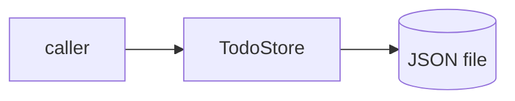

````chatop
<<<CHATOP turn=@TURN@>>>
@@summary AS-BUILT for agentic-todo
@@doc docs/AS-BUILT.md
# As-built: agentic-todo

## Purpose (inferred)
A minimal persistent todo list library.

## Architecture as it is

- `todo.Todo`: dataclass (id, title, done)
- `todo.TodoStore(path)`: `add(title) -> Todo`, `complete(id)`, `open_items() -> list[Todo]`; persists on every change

## Build / test
`python -m pytest -q` (pytest pythonpath = ".")

## Conventions
Single module, type-annotated, dataclasses, JSON list persistence. Follows AGENTS.md.

## Gaps
- IDs are `len(items)+1`: unique only while nothing is ever deleted (there is no delete today). *(verified in code)*
- No CLI or entry point *(verified)*
- No typecheck/lint configuration

## Glossary
open item = a todo with done == False
@@end
@@check typecheck python -m mypy --strict todo.py
@@decision Treat AGENTS.md conventions as binding for this repo
<<<END>>>
````
