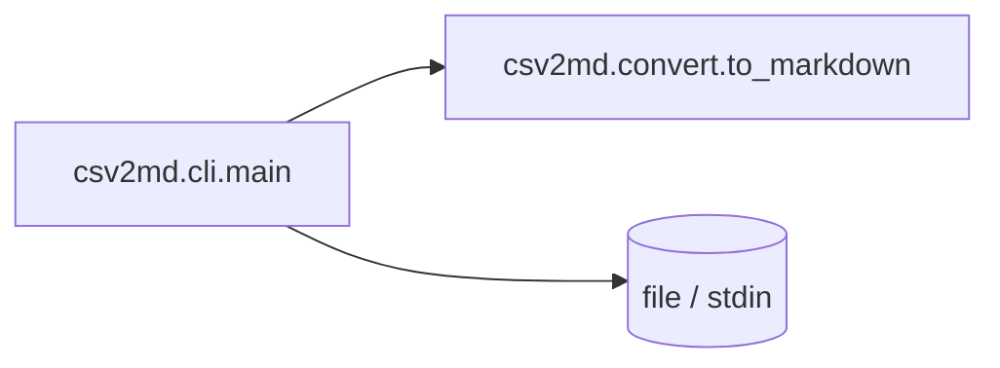

````chatop
<<<CHATOP turn=@TURN@>>>
@@summary SPEC with pure core + thin CLI; check commands proposed
@@doc docs/SPEC.md
# SPEC: csv2md

## 1. Architecture


## 2. Boundaries
- `csv2md.convert` (pure core): `to_markdown(rows: list[list[str]]) -> str`
- `csv2md.cli` (I/O shell): `main(argv: list[str] | None = None, stdin: TextIO | None = None) -> int`
- Import rule: `cli` → `convert`; `convert` imports only the stdlib.

## 3. Data model
Rows are `list[list[str]]`; the first row is the header.

## 4. Errors
A missing file prints an error to stderr and returns 2.

## 6. Tooling
pytest; mypy --strict; layout `src/csv2md`, `tests/`.

## 7. Test strategy
Unit tests for `to_markdown` (AC-1.x); CLI tests with an injected stdin and a temp file (AC-2.x).
@@end
@@doc docs/adr/0001-pure-core-thin-cli.md
# ADR 0001: Pure core, thin CLI
Context: we want fast tests and reuse as a library.
Decision: all logic lives in `convert`; the CLI only parses arguments and handles I/O.
Alternatives: a single module (harder to test).
Consequences: two modules; trivial to add other front ends.
@@end
@@check test python -m pytest -q
@@check typecheck python -m mypy --strict src
@@advance
<<<END>>>
````
